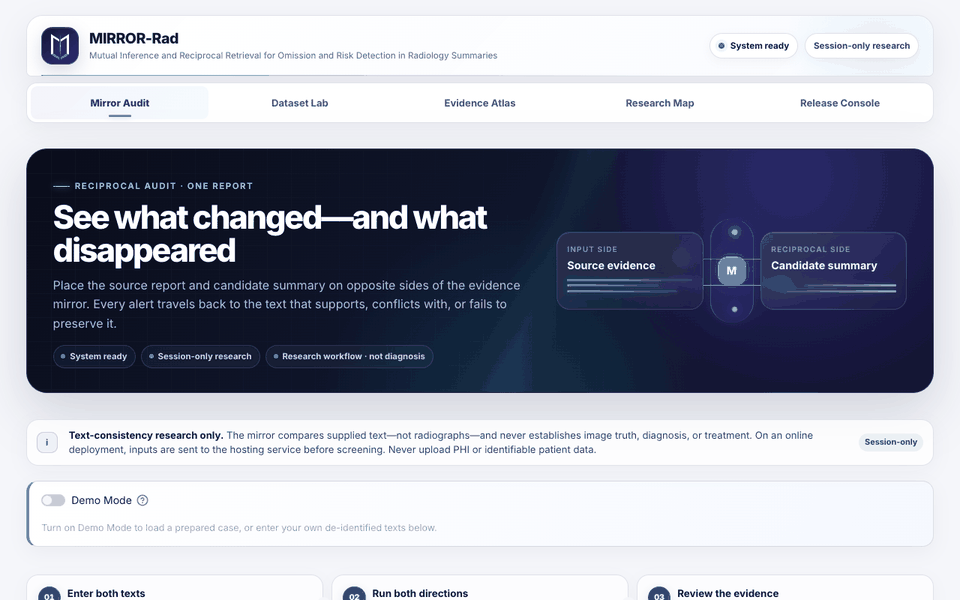
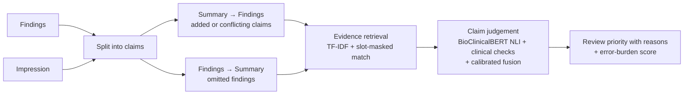

# MIRROR-Rad

**Checks a radiology summary against its source report, in both directions.**

[](https://github.com/AbineshSenthil/mirror-rad/actions/workflows/ci.yml)
&nbsp;**[Live demo](https://mirror-rad.streamlit.app/)** · [How it works](#how-it-works) · [Results](#results) · [Run it locally](#run-it-locally)



A generated or edited Impression can go wrong in two ways. It can **add or change** something: an invented
pneumothorax, the wrong side, the wrong severity. Or it can **leave out** a finding from the report. MIRROR-Rad
splits both texts into short claims, finds the evidence for each claim in the other text, judges it with a
fine-tuned clinical language model plus explicit clinical checks, and returns a review priority together with the
exact claims and evidence behind it.

> **Research use only.** MIRROR-Rad compares text with text. It does not read images, establish clinical truth or
> replace a radiologist. Never enter identifiable patient data; the public demo is for synthetic or de-identified text.

## How it works



1. **Claims.** Each text is split into checkable statements. Numbered impressions, abbreviations and decimal
   measurements are handled so "1." or "aneurysms." never break a claim.
2. **Evidence.** For every claim, the most relevant sentences in the other text are retrieved with TF-IDF, plus a
   *slot-masked* view in which values such as side, device or severity are masked, so a changed value
   (left → right, PICC → chest tube) still finds its counterpart.
3. **Judgement.** A [Bio_ClinicalBERT](https://huggingface.co/emilyalsentzer/Bio_ClinicalBERT) model fine-tuned for
   three-way NLI (supported / contradicted / unsupported) is combined with entity-level checks for negation,
   laterality, severity, temporal change, measurements and devices, through a calibrated logistic fusion.
4. **Decision.** Transparent rules ([`src/radtrace/routing.py`](src/radtrace/routing.py)) turn claim decisions into
   a priority, each with a stated reason:
   - **High**: a conflict, an invented finding, or a missing critical finding (pneumothorax, free air, airway
     tubes, central lines, chest tubes, enteric tubes, pacemakers and defibrillators).
   - **Review**: another unsupported or uncertain claim, or a missing non-critical finding.
   - **Routine**: anything else. Normal statements that a concise impression leaves out ("lungs are clear",
     "no effusion") do not raise the priority.

   In the Dataset Lab, reports are sorted by priority, then by a count-aware **error-burden score** (the score
   evaluated on RadEvalX). That score still counts omitted normal statements, so it is a tie-breaker, not a verdict.

## Results

All numbers come from the bundled aggregate ledger, [`reports/public/evaluation_summary.json`](reports/public/evaluation_summary.json),
which keeps metrics and confidence intervals but no report text or row-level predictions.

| Benchmark | What it tests | Result |
|---|---|---|
| **RadEvalX**: 100 generated reports with two-radiologist consensus error labels | Ranking reports that contain clinically significant errors (error-burden score) | AUROC **0.674** (95% CI 0.552–0.781); reviewing the top 20% captures 29.8% of significant errors. CheXbert 0.742; the MIRROR-Rad minus CheXbert difference is not significant (95% CI −0.215 to 0.072). BERTScore 0.607, RadCliQ 0.595, BLEU-4 0.581, RadGraph-F1 0.574 |
| **ReXErr**, sentences in report context: 7,085 clinician-designed errors, 10,790 clean sentences | Catching an injected error in a sentence | AUROC **0.955** with the shipped error-burden score (recall 0.623, specificity 0.937). An extra sentence-level calibrator fitted on ReXErr, which is not shipped, reaches AUROC 0.994 |
| **ReXErr adaptation holdout**: 12,266 patient-disjoint claims | Three-way claim classification | Macro-F1 **0.901**, contradiction recall 0.915, unsupported recall 0.810, ECE 0.008 |
| **Controlled Open-I test**: 2,272 rule-generated claims | Three-way claim classification | Macro-F1 **0.962**, contradiction recall 0.954 |

**Read these with the limits in mind:**

- **RadEvalX is the only human-labelled benchmark.** It has 100 reports, and MIRROR-Rad does not beat CheXbert on it.
- **Not untouched holdouts.** ReXErr and RadEvalX were looked at during development, so these results are iterative evidence.
- **The controlled test uses rule-generated edits.** Its unsupported claims come from seven template sentences
  (`_UNSUPPORTED_CLAIMS` in [`src/radtrace/mutations.py`](src/radtrace/mutations.py)), so the unsupported recall of
  1.000 there mainly shows that the templates are recognised. Even a TF-IDF-only baseline reaches 0.899.
- **The benchmarks predate version 1.1.** The claim-splitting fixes and rule-based routing (below) have not been re-run
  on them, because those runs need the licensed datasets.
- **The archived report router is evaluated but not used.** It scored report-level ReXErr AUROC 0.944, but on 2,674
  changed reports against only 34 unchanged-meaning ones (MCC 0.34), and it is no longer used for decisions (see below).

## What changed in 1.1

**Review priority now comes from transparent rules instead of a learned router.** The 1.0 router was trained on
ReXErr report pairs of almost identical length. A real impression is far shorter than its findings, which put the
router's length feature 5 to 14 standard deviations outside its training range in the examples below. Concise,
faithful impressions were routed High, an invented pneumothorax Review, and an omitted pneumothorax Routine:

| Findings → summary (demo cases and hand-written examples) | 1.0 router | 1.1 rules |
|---|---|---|
| Normal report → "No acute cardiopulmonary abnormality." | High | Routine |
| Normal report → "Normal chest radiograph." | High | Routine |
| Demo case "Supported summary" | Review | Routine |
| "Two small pulmonary nodules. No pneumothorax." → adds "Large right pneumothorax." | Review | High |
| "Small left pneumothorax. Mild cardiomegaly." → "Mild cardiomegaly." | Routine | High |
| Demo cases "Laterality conflict" and "Severity change" | Review | High |

These cases are locked in by [`tests/test_model_behaviour.py`](tests/test_model_behaviour.py). The rules were checked
on the 9 demo cases and 11 hand-written pairs; they have not been re-benchmarked.

**Also fixed:**

- **Dataset Lab crash.** The Dataset Lab no longer crashes after a batch run; it used to fail while opening a case from the queue.
- **Claim splitting.** Words ending in "ms." ("aneurysms.", "symptoms.") no longer merge two sentences, numbered
  impressions no longer produce "1." / "2." claims, "1) … 2) …" lists are split, and a lead-in such as "Lines:"
  stays with its item.
- **`serve` command.** `python -m radtrace serve` finds the bundled evaluation ledger.
- **Tests and CI.** Added a test suite, CI, `pyproject.toml`, and a one-command reseal script for the release manifest.

## Run it locally

Install [Git LFS](https://git-lfs.com/) first so the 413 MB checkpoint downloads instead of a pointer file.
Python 3.11 is required.

```bash
git lfs install
git clone https://github.com/AbineshSenthil/mirror-rad.git
cd mirror-rad
python3.11 -m venv .venv && source .venv/bin/activate   # Windows: py -3.11 -m venv .venv; .\.venv\Scripts\Activate.ps1
pip install -r requirements.txt
streamlit run app.py
```

Open <http://localhost:8501>. Inference runs on CPU in a few seconds per report pair.

From the command line:

```bash
pip install -e . --no-deps
mirror-rad audit --findings "Small left pneumothorax. No pleural effusion." --impression "Small right pneumothorax."
```

The Dataset Lab accepts UTF-8 CSV, JSON or JSONL with `findings` and `impression` columns (optional: `case_id`,
`generator`, `site`, `split`, `subgroup`), up to 100 pairs and 10 MB per upload on the public demo.

## Development

```bash
pip install -r requirements.txt pytest ruff
ruff check .
pytest          # model and app tests run when the real checkpoint is present (git lfs pull)
```

CI runs lint and the tests on every push to `main` and every pull request, without downloading the checkpoint; the model-dependent tests skip there.

The app checks a SHA-256 manifest of its code, model and evidence files before it runs any audit, so a half-updated
deployment fails closed instead of running a mismatched model. **After changing `app.py` or anything in
`src/radtrace`, run `python scripts/reseal_release.py` and commit the manifest with your change.** CI fails if you forget.

```
app.py                      Streamlit app (five pages)
src/radtrace/               engine: text, retrieval, clinical_rules, nli, verifier, bidirectional, routing
artifacts/                  fine-tuned checkpoint (Git LFS), fusion model, archived router, release manifest
reports/public/             aggregate evaluation ledger
tests/                      unit, model-behaviour and Streamlit smoke tests
scripts/reseal_release.py   regenerate the release manifest
```

## Data and licensing

Project code is MIT-licensed. The checkpoint is fine-tuned from `emilyalsentzer/Bio_ClinicalBERT` (MIT); see
[`THIRD_PARTY_NOTICES.md`](THIRD_PARTY_NOTICES.md). No dataset is redistributed here. Training and evaluation used the
public Open-I chest X-ray reports, plus ReXErr and RadEvalX under their own licences. The demo cases are de-identified
Open-I excerpts, some with controlled edits.
